<h3>Learn, practice and defend, with resources that are still alive.</h3>

**[Website](https://ethos6.github.io/Hacking/)** · **[Learning paths](#learning-paths)** · **[All resources](#contents)** · **[Contribute](CONTRIBUTING.md)**

---

Security lists age badly. Links die, tools stop being maintained, and nothing tells you which entries are still worth your time. **Hacking** is a curated map of security courses, labs, tools, references and lists that **checks itself every week**: each GitHub project shows its stars, its last update and whether it is still maintained.

> [!IMPORTANT]
> Everything here is for **learning, defending systems and authorized testing**. Only test systems you own or have written permission to test. See [Ethics and legal use](#ethics-and-legal-use).

## Why this list

| | Typical "awesome" lists | **Hacking** |
| :-- | :-- | :-- |
| Freshness | Entries added once, rarely revisited | Weekly health check of every GitHub project, with archived and moved repos flagged automatically |
| Signal | Only a name and a one-liner | Type, skill level, stars, last update and maintenance status for each entry |
| Where to start | A wall of links | [Learning paths](#learning-paths) that order resources from first steps to advanced |
| Practice | Tools only | Free courses, wargames and vulnerable labs to practice legally |
| Reuse | Markdown only | Structured data, a [searchable website](https://ethos6.github.io/Hacking/) and a [JSON feed](https://ethos6.github.io/Hacking/api/resources.json) |

## Learning paths

Not sure where to begin? Pick a path. Each one is an ordered route through the resources below, from first steps to advanced practice.

| Path | For you if you want to… | Level |
| :-- | :-- | :-- |
| 🧭 [**Start here**](paths/start-here.md) | build the foundations: Linux, networking, the web and your first CTFs | Beginner |
| 🌐 [**Web application security**](paths/web.md) | find and fix vulnerabilities in web apps and APIs | Beginner → Advanced |
| 🛡️ [**Blue team and incident response**](paths/blue-team.md) | detect, investigate and respond to attacks | Beginner → Advanced |
| 🏰 [**Networks and Active Directory**](paths/network-ad.md) | understand enterprise networks and how to harden them | Intermediate → Advanced |
| 🔬 [**Reverse engineering and binaries**](paths/reverse-engineering.md) | read compiled code, analyze malware and understand memory bugs | Intermediate → Advanced |
| ☁️ [**Cloud and DevSecOps**](paths/cloud-devsecops.md) | secure code, pipelines, containers and cloud accounts | Beginner → Intermediate |

## Contents

<!-- resources:start (generated by scripts/build.mjs from data/*.json, do not edit by hand) -->

<b>125 resources</b> in <b>14 categories</b> · <b>114</b> GitHub projects health-checked weekly (last check: 2026-11-01) 
97 active · 12 maintained · 5 slow · 0 stale · 0 archived

**Jump to:** [Learn and practice](#learn-and-practice) · [Vulnerable labs](#vulnerable-labs) · [Web and API security](#web-and-api-security) · [Recon and OSINT](#recon-and-osint) · [Network and Active Directory](#network-and-active-directory) · [Exploitation and privilege escalation](#exploitation-and-privilege-escalation) · [Reverse engineering and malware analysis](#reverse-engineering-and-malware-analysis) · [Detection, forensics and incident response](#detection-forensics-and-incident-response) · [Cloud and DevSecOps](#cloud-and-devsecops) · [Mobile security](#mobile-security) · [Cryptography and passwords](#cryptography-and-passwords) · [Hardware, IoT and specialized systems](#hardware-iot-and-specialized-systems) · [AI security](#ai-security) · [References and meta-lists](#references-and-meta-lists)

**Health:** 🟢 Active (updated in the last 6 months) · 🔵 Maintained (updated in the last 18 months) · 🟡 Slow (no update for 18 months to 3 years) · 🔴 Stale (no update for over 3 years) · ⚫ Archived (archived by its owner). Stars and dates come from the GitHub API.

### Learn and practice

Free courses, wargames and hands-on platforms. Start here.

| Resource | Type | Level | What it is | Health |
| :-- | :-- | :-- | :-- | :-- |
| [**Awesome Cyber Security University**](https://github.com/brootware/awesome-cyber-security-university) | List | Beginner | A self-study curriculum of free resources, ordered from introduction to purple teaming. | 🟢 ★ 3.7k · Oct 2026 |
| [**Awesome Cyber Skills**](https://github.com/joe-shenouda/awesome-cyber-skills) | List | Beginner | Legal places to practice hacking skills: challenge sites, vulnerable apps and wargames. | 🟢 ★ 4.8k · Sep 2026 |
| [**CryptoHack**](https://cryptohack.org/) | Course | Intermediate | Free platform for learning modern cryptography by breaking flawed implementations of RSA, AES, elliptic curves and more. | Free |
| [**CTF Wiki**](https://ctf-wiki.org/) | Reference | Beginner | Community knowledge base covering CTF categories: web, crypto, reverse engineering, pwn and misc. | 🟢 ★ 9.7k · Aug 2026 |
| [**CTFtime**](https://ctftime.org/) | Platform | All | Calendar of upcoming capture-the-flag events, team rankings and an archive of challenge writeups. | — |
| [**Exploit Education**](https://exploit.education/) | Lab | Intermediate | Downloadable VMs for learning exploitation: Nebula (Linux privilege escalation), Phoenix (memory corruption) and Fusion (advanced). | — |
| [**Hack The Box**](https://www.hackthebox.com/) | Platform | Intermediate | Hacking labs and machines. The free plan includes Starting Point tiers 0-2 and retired machines in Guided Mode. Free plan with limits; paid plans unlock more. | — |
| [**Hacker101**](https://www.hacker101.com/) | Course | Beginner | HackerOne's free web security class with videos and CTF-style exercises for aspiring bug bounty hunters. | 🟡 ★ 15k · Feb 2025 |
| [**OverTheWire**](https://overthewire.org/wargames/) | Platform | Beginner | Classic wargames played over SSH. Start with Bandit for Linux basics, then move on to web (Natas) and binary games. | — |
| [**picoCTF (CyLab Security Academy)**](https://picoctf.org/) | Course | Beginner | Carnegie Mellon University's free learning platform, home of the picoCTF beginner competition. | Free |
| [**pwn.college**](https://pwn.college/) | Course | Beginner | Arizona State University's free, hands-on 'dojo' that teaches core security skills from the terminal up to binary exploitation. | Free |
| [**TryHackMe**](https://tryhackme.com/) | Platform | Beginner | Guided rooms and learning paths in the browser. The free plan includes free rooms and a 1-hour daily AttackBox. Free plan with limits; paid plans unlock all paths. | — |
| [**Web Security Academy**](https://portswigger.net/web-security) | Course | Beginner | Free interactive web security training from PortSwigger with hands-on labs for SQL injection, XSS, SSRF, access control and more. | Free |

<a href="#contents">↑ back to contents</a>

### Vulnerable labs

Deliberately vulnerable apps and environments to practice on legally, on your own machine.

| Resource | Type | Level | What it is | Health |
| :-- | :-- | :-- | :-- | :-- |
| [**DVWA**](https://github.com/digininja/DVWA) | Lab | Beginner | Damn Vulnerable Web Application: a classic PHP/MySQL app with adjustable difficulty for practicing common web flaws. | 🟢 ★ 14k · Oct 2026 |
| [**GOAD (Game of Active Directory)**](https://github.com/Orange-Cyberdefense/GOAD) | Lab | Advanced | Builds a vulnerable multi-domain Active Directory lab to practice AD attack and defense techniques. | 🟢 ★ 8.6k · Oct 2026 |
| [**OWASP Juice Shop**](https://owasp.org/www-project-juice-shop/) | Lab | Beginner | A modern, intentionally insecure web shop with 100+ challenges covering the OWASP Top 10 and beyond. | 🟢 ★ 14k · Oct 2026 |
| [**OWASP WebGoat**](https://owasp.org/www-project-webgoat/) | Lab | Beginner | Lessons plus a deliberately insecure Java application that explains each vulnerability as you exploit it. | 🟢 ★ 9.4k · Oct 2026 |
| [**Vulhub**](https://vulhub.org/) | Lab | Intermediate | Ready-made Docker Compose environments that reproduce real-world vulnerabilities for study. | 🟢 ★ 21k · Oct 2026 |

<a href="#contents">↑ back to contents</a>

### Web and API security

Testing guides, checklists, scanners and payload references for web apps and APIs.

| Resource | Type | Level | What it is | Health |
| :-- | :-- | :-- | :-- | :-- |
| [**API Security Checklist**](https://github.com/shieldfy/API-Security-Checklist) | Reference | Beginner | Short checklist of countermeasures for designing, testing and releasing APIs. | 🟢 ★ 23k · Jul 2026 |
| [**Awesome AppSec**](https://github.com/paragonie/awesome-appsec) | List | Beginner | Resources for developers learning to build secure applications. | 🟡 ★ 7.1k · Feb 2025 |
| [**Awesome Node.js Security**](https://github.com/lirantal/awesome-nodejs-security) | List | Intermediate | Node.js security tools, educational material, companies and talks. | 🟢 ★ 3.1k · Oct 2026 |
| [**Awesome Web Hacking**](https://github.com/infoslack/awesome-web-hacking) | List | Beginner | Books, documentation, tools and labs for web application penetration testing. | 🟢 ★ 7.3k · Oct 2026 |
| [**Awesome Web Security**](https://github.com/qazbnm456/awesome-web-security) | List | Intermediate | Curated web security materials: XSS, SQLi, SSRF, deserialization, browser exploitation and more. | 🟢 ★ 14k · Sep 2026 |
| [**ffuf**](https://github.com/ffuf/ffuf) | Tool | Intermediate | Fast web fuzzer for content discovery, virtual hosts and parameter fuzzing. | 🟢 ★ 17k · Sep 2026 |
| [**Gobuster**](https://github.com/OJ/gobuster) | Tool | Beginner | Brute-forces directories, DNS subdomains, virtual hosts and cloud buckets. | 🔵 ★ 14k · Jan 2026 |
| [**Nuclei**](https://github.com/projectdiscovery/nuclei) | Tool | Intermediate | Template-based vulnerability scanner with a large community library of checks. | 🟢 ★ 33k · Oct 2026 |
| [**OWASP ASVS**](https://owasp.org/www-project-application-security-verification-standard/) | Reference | Intermediate | Application Security Verification Standard: testable security requirements for designing and verifying apps. | 🟢 ★ 3.7k · Oct 2026 |
| [**OWASP Top 10**](https://owasp.org/www-project-top-ten/) | Reference | Beginner | The standard awareness document for the most critical web application security risks (2025 edition). | Free |
| [**OWASP Web Security Testing Guide**](https://owasp.org/www-project-web-security-testing-guide/) | Reference | Intermediate | Comprehensive methodology for testing web applications, organized by test category. | 🟢 ★ 10k · Oct 2026 |
| [**PayloadsAllTheThings**](https://github.com/swisskyrepo/PayloadsAllTheThings) | Reference | Intermediate | Payloads, bypasses and methodology notes for web application testing and CTFs. | 🟢 ★ 82k · Oct 2026 |
| [**SecLists**](https://github.com/danielmiessler/SecLists) | Reference | Beginner | The standard collection of wordlists for discovery, fuzzing, usernames and passwords. | 🟢 ★ 74k · Nov 2026 |
| [**sqlmap**](https://sqlmap.org/) | Tool | Intermediate | Automates detecting and exploiting SQL injection flaws in applications you are authorized to test. | 🟢 ★ 39k · Oct 2026 |
| [**ZAP**](https://www.zaproxy.org/) | Tool | Beginner | Open source web app scanner and intercepting proxy for finding vulnerabilities during development and testing. | 🟢 ★ 16k · Nov 2026 |

<a href="#contents">↑ back to contents</a>

### Recon and OSINT

Asset discovery, port scanning and open-source intelligence.

| Resource | Type | Level | What it is | Health |
| :-- | :-- | :-- | :-- | :-- |
| [**Awesome Asset Discovery**](https://github.com/redhuntlabs/Awesome-Asset-Discovery) | List | Intermediate | Resources for the asset discovery phase of a security assessment. | 🟡 ★ 2.9k · Jan 2025 |
| [**Awesome OSINT**](https://github.com/jivoi/awesome-osint) | List | Beginner | Large collection of open-source intelligence tools and resources, organized by data source. | 🟢 ★ 31k · Oct 2026 |
| [**httpx**](https://github.com/projectdiscovery/httpx) | Tool | Beginner | Fast HTTP probing toolkit to find live hosts and collect titles, status codes and technologies. | 🟢 ★ 11k · Oct 2026 |
| [**masscan**](https://github.com/robertdavidgraham/masscan) | Tool | Intermediate | Very fast asynchronous port scanner for large address ranges. | 🟢 ★ 26k · Oct 2026 |
| [**Nmap**](https://nmap.org/) | Tool | Beginner | The network mapper: host discovery, port scanning, service and OS detection, plus the NSE scripting engine. | 🟢 ★ 14k · Oct 2026 |
| [**OWASP Amass**](https://github.com/owasp-amass/amass) | Tool | Intermediate | In-depth attack surface mapping and external asset discovery. | 🟢 ★ 15k · Oct 2026 |
| [**RustScan**](https://github.com/bee-san/RustScan) | Tool | Beginner | Fast port scanner that finds open ports quickly and can hand results to Nmap. | 🟢 ★ 21k · Oct 2026 |
| [**subfinder**](https://github.com/projectdiscovery/subfinder) | Tool | Beginner | Passive subdomain discovery using many online sources. | 🟢 ★ 15k · Oct 2026 |

<a href="#contents">↑ back to contents</a>

### Network and Active Directory

Packet analysis, network monitoring and Windows/AD assessment.

| Resource | Type | Level | What it is | Health |
| :-- | :-- | :-- | :-- | :-- |
| [**Awesome PCAP Tools**](https://github.com/caesar0301/awesome-pcaptools) | List | Intermediate | Tools for processing and analyzing network traffic captures. | 🔵 ★ 3.4k · Sep 2025 |
| [**Awesome Suricata**](https://github.com/satta/awesome-suricata) | List | Intermediate | Rules, tools, dashboards and documentation for Suricata. | 🟢 ★ 247 · Aug 2026 |
| [**BloodHound**](https://github.com/SpecterOps/BloodHound) | Tool | Intermediate | Maps relationships in Active Directory and Entra ID to reveal attack paths so defenders can remove them. | 🟢 ★ 3.5k · Oct 2026 |
| [**Impacket**](https://github.com/fortra/impacket) | Tool | Advanced | Python classes and example scripts for working with network protocols such as SMB, Kerberos and MSRPC. | 🟢 ★ 16k · Oct 2026 |
| [**Suricata**](https://suricata.io/) | Tool | Intermediate | High-performance IDS/IPS and network security monitoring engine. | 🟢 ★ 6.8k · Oct 2026 |
| [**Wireshark**](https://www.wireshark.org/) | Tool | Beginner | The standard network protocol analyzer for capturing and inspecting traffic. | 🟢 ★ 10k · Nov 2026 |
| [**Zeek**](https://zeek.org/) | Tool | Intermediate | Network security monitoring platform that turns traffic into rich, structured logs. | 🟢 ★ 8.2k · Oct 2026 |

<a href="#contents">↑ back to contents</a>

### Exploitation and privilege escalation

Frameworks and references used in authorized penetration tests and CTFs.

| Resource | Type | Level | What it is | Health |
| :-- | :-- | :-- | :-- | :-- |
| [**Awesome Bug Bounty**](https://github.com/djadmin/awesome-bug-bounty) | List | Beginner | Bug bounty programs, write-ups and getting-started resources. | 🔵 ★ 6k · Mar 2026 |
| [**Awesome Penetration Testing**](https://github.com/enaqx/awesome-pentest) | List | Intermediate | Broad collection of penetration testing resources, tools and references. | 🟢 ★ 28k · Jul 2026 |
| [**GTFOBins**](https://gtfobins.org/) | Reference | Intermediate | Curated list of Unix binaries that can be abused to bypass local security restrictions. | 🟢 ★ 14k · May 2026 |
| [**Linux Kernel Exploitation**](https://github.com/xairy/linux-kernel-exploitation) | List | Advanced | Links on Linux kernel fuzzing, exploitation techniques and mitigations. | 🟢 ★ 6.7k · Oct 2026 |
| [**LOLBAS**](https://lolbas-project.github.io/) | Reference | Intermediate | Windows binaries, scripts and libraries that can be misused, documented for attackers and defenders alike. | 🟢 ★ 8.9k · Sep 2026 |
| [**Metasploit Framework**](https://www.metasploit.com/) | Tool | Intermediate | Widely used framework for developing, testing and running exploits in authorized engagements. | 🟢 ★ 39k · Oct 2026 |
| [**PEASS-ng**](https://github.com/peass-ng/PEASS-ng) | Tool | Intermediate | linPEAS and winPEAS: scripts that highlight local privilege escalation paths on Linux and Windows. | 🟢 ★ 21k · Nov 2026 |
| [**pwndbg**](https://github.com/pwndbg/pwndbg) | Tool | Intermediate | GDB and LLDB plugin that makes debugging and exploit development much easier. | 🟢 ★ 11k · Oct 2026 |
| [**pwntools**](https://github.com/Gallopsled/pwntools) | Tool | Intermediate | Python library for CTF and exploit development: process I/O, ROP chains, shellcraft and more. | 🟢 ★ 14k · Oct 2026 |

<a href="#contents">↑ back to contents</a>

### Reverse engineering and malware analysis

Disassemblers, debuggers, instrumentation and analysis references.

| Resource | Type | Level | What it is | Health |
| :-- | :-- | :-- | :-- | :-- |
| [**Awesome Executable Packing**](https://github.com/packing-box/awesome-executable-packing) | List | Advanced | Research, tools and datasets on executable packing and unpacking. | 🟢 ★ 1.6k · Oct 2026 |
| [**Awesome Malware Persistence**](https://github.com/Karneades/awesome-malware-persistence) | List | Advanced | Techniques malware uses to persist, with detection resources. | 🟢 ★ 318 · Aug 2026 |
| [**Awesome Reversing**](https://github.com/HACKE-RC/awesome-reversing) | List | Intermediate | Reverse engineering courses, books, tools and practice targets. | 🟡 ★ 1.5k · Mar 2025 |
| [**Awesome YARA**](https://github.com/pedramamini/awesome-yara) | List | Intermediate | YARA rules, tools and people to follow. | 🟢 ★ 4.3k · Jun 2026 |
| [**capa**](https://github.com/mandiant/capa) | Tool | Intermediate | Identifies capabilities in executables, such as 'communicates over HTTP' or 'encrypts data'. | 🟢 ★ 6.3k · Nov 2026 |
| [**Cutter**](https://cutter.re/) | Tool | Intermediate | Free reverse engineering GUI powered by the Rizin framework. | 🟢 ★ 20k · Sep 2026 |
| [**Frida**](https://frida.re/) | Tool | Intermediate | Dynamic instrumentation toolkit for hooking functions in running processes on desktop and mobile. | 🟢 ★ 23k · Nov 2026 |
| [**Ghidra**](https://ghidra-sre.org/) | Tool | Intermediate | Software reverse engineering suite from the NSA with a disassembler, decompiler and scripting. | 🟢 ★ 97k · Oct 2026 |
| [**radare2**](https://www.radare.org/) | Tool | Advanced | Scriptable command-line framework for reverse engineering and binary analysis. | 🟢 ★ 25k · Nov 2026 |
| [**x64dbg**](https://x64dbg.com/) | Tool | Intermediate | Open source x64/x32 debugger for Windows. | 🟢 ★ 50k · Oct 2026 |
| [**YARA**](https://virustotal.github.io/yara/) | Tool | Intermediate | Pattern-matching tool for identifying and classifying malware samples. | 🟢 ★ 10k · Oct 2026 |

<a href="#contents">↑ back to contents</a>

### Detection, forensics and incident response

DFIR tooling, detection rules, threat hunting and adversary emulation.

| Resource | Type | Level | What it is | Health |
| :-- | :-- | :-- | :-- | :-- |
| [**Atomic Red Team**](https://atomicredteam.io/) | Tool | Intermediate | Small, portable tests mapped to ATT&CK for validating your detections. | 🟢 ★ 13k · Oct 2026 |
| [**Autopsy**](https://www.autopsy.com/) | Tool | Intermediate | Digital forensics platform and GUI for The Sleuth Kit. | 🔵 ★ 3.4k · May 2026 |
| [**Awesome Detection Engineering**](https://github.com/infosecB/awesome-detection-engineering) | List | Intermediate | Resources for building and maintaining detections. | 🟢 ★ 1.4k · Oct 2026 |
| [**Awesome Forensics**](https://github.com/Cugu/awesome-forensics) | List | Intermediate | Forensic analysis tools and learning resources. | 🟢 ★ 5.2k · Sep 2026 |
| [**Awesome Honeypots**](https://github.com/paralax/awesome-honeypots) | List | Intermediate | Honeypots, deception tools and related components. | 🟢 ★ 11k · Jun 2026 |
| [**Awesome Incident Response**](https://github.com/meirwah/awesome-incident-response) | List | Intermediate | Tools and resources for incident response teams. | 🟢 ★ 9.5k · Oct 2026 |
| [**Awesome IOCs**](https://github.com/sroberts/awesome-iocs) | List | Intermediate | Sources of indicators of compromise. | 🟢 ★ 1k · Oct 2026 |
| [**Awesome Threat Intelligence**](https://github.com/hslatman/awesome-threat-intelligence) | List | Intermediate | Threat intelligence sources, formats, frameworks and tools. | 🟢 ★ 11k · Oct 2026 |
| [**Caldera**](https://github.com/apache/caldera) | Tool | Advanced | Automated adversary emulation platform for testing defenses, originally from MITRE. | 🟢 ★ 7.5k · Aug 2026 |
| [**MITRE ATT&CK**](https://attack.mitre.org/) | Reference | Beginner | Free knowledge base of adversary tactics and techniques based on real-world observations. | Free |
| [**osquery**](https://osquery.io/) | Tool | Intermediate | Query your operating system like a database with SQL for monitoring and investigations. | 🟢 ★ 24k · Oct 2026 |
| [**Plaso**](https://plaso.readthedocs.io/) | Tool | Advanced | Builds super-timelines from many forensic artifact types. | 🟢 ★ 2.2k · Nov 2026 |
| [**Sigma**](https://github.com/SigmaHQ/sigma) | Reference | Intermediate | Generic, shareable detection rule format with thousands of community rules for SIEMs. | 🟢 ★ 11k · Oct 2026 |
| [**ThreatHunter-Playbook**](https://github.com/OTRF/ThreatHunter-Playbook) | Reference | Intermediate | Community threat hunting playbooks with detection logic and datasets. | 🔵 ★ 4.7k · Dec 2025 |
| [**Velociraptor**](https://docs.velociraptor.app/) | Tool | Intermediate | Endpoint visibility and DFIR tool for collecting and hunting across many machines. | 🟢 ★ 4.4k · Oct 2026 |
| [**Volatility 3**](https://github.com/volatilityfoundation/volatility3) | Tool | Advanced | Memory forensics framework for extracting artifacts from RAM captures. | 🟢 ★ 4.6k · Oct 2026 |

<a href="#contents">↑ back to contents</a>

### Cloud and DevSecOps

Cloud posture, container and code scanning, secrets detection, CI/CD security.

| Resource | Type | Level | What it is | Health |
| :-- | :-- | :-- | :-- | :-- |
| [**Awesome CI/CD Attacks**](https://github.com/TupleType/awesome-cicd-attacks) | List | Advanced | Research on attacking and hardening CI/CD systems and deployment pipelines. | 🟢 ★ 638 · Jun 2026 |
| [**Gitleaks**](https://github.com/gitleaks/gitleaks) | Tool | Beginner | Detects hardcoded secrets in Git repositories and files. | 🟢 ★ 31k · Oct 2026 |
| [**OSV-Scanner**](https://github.com/google/osv-scanner) | Tool | Beginner | Finds known vulnerabilities in your dependencies using the OSV database. | 🟢 ★ 11k · Oct 2026 |
| [**Prowler**](https://github.com/prowler-cloud/prowler) | Tool | Intermediate | Security posture checks for AWS, Azure, GCP and Kubernetes against common benchmarks. | 🟢 ★ 15k · Oct 2026 |
| [**Semgrep**](https://semgrep.dev/) | Tool | Beginner | Fast static analysis with readable rules for finding bugs and enforcing secure code. | 🟢 ★ 17k · Oct 2026 |
| [**Static Analysis Tools**](https://analysis-tools.dev/) | List | Beginner | Large directory of static analysis tools and linters for every language. | 🟢 ★ 15k · Oct 2026 |
| [**Trivy**](https://trivy.dev/) | Tool | Beginner | Scans containers, filesystems, Git repos and IaC for vulnerabilities, misconfigurations and secrets. | 🟢 ★ 39k · Oct 2026 |
| [**TruffleHog**](https://github.com/trufflesecurity/trufflehog) | Tool | Beginner | Finds and verifies leaked credentials across Git, cloud storage and chat tools. | 🟢 ★ 29k · Oct 2026 |

<a href="#contents">↑ back to contents</a>

### Mobile security

Android and iOS testing guides and tools.

| Resource | Type | Level | What it is | Health |
| :-- | :-- | :-- | :-- | :-- |
| [**Android Security Awesome**](https://github.com/ashishb/android-security-awesome) | List | Intermediate | Android security tools, academic research and learning material. | 🟢 ★ 9.8k · Oct 2026 |
| [**macOS and iOS Security Awesome**](https://github.com/ashishb/osx-and-ios-security-awesome) | List | Intermediate | macOS and iOS security tools and resources. | 🟢 ★ 1.8k · Oct 2026 |
| [**MobSF**](https://github.com/MobSF/Mobile-Security-Framework-MobSF) | Tool | Beginner | Automated static and dynamic analysis for Android and iOS apps. | 🟢 ★ 22k · Nov 2026 |
| [**OWASP MASTG**](https://mas.owasp.org/MASTG/) | Reference | Intermediate | Mobile Application Security Testing Guide: the standard manual for testing Android and iOS apps. | 🟢 ★ 13k · Nov 2026 |

<a href="#contents">↑ back to contents</a>

### Cryptography and passwords

Learning cryptography and auditing password strength.

| Resource | Type | Level | What it is | Health |
| :-- | :-- | :-- | :-- | :-- |
| [**Awesome Cryptography**](https://github.com/sobolevn/awesome-cryptography) | List | Intermediate | Cryptography libraries, books, courses and tools. | 🟢 ★ 7.2k · Jul 2026 |
| [**Awesome Password Cracking**](https://github.com/n0kovo/awesome-password-cracking) | List | Intermediate | Tools, research, wordlists and papers on password cracking. | 🟢 ★ 1.1k · Sep 2026 |
| [**hashcat**](https://hashcat.net/hashcat/) | Tool | Intermediate | GPU-accelerated password recovery for auditing hash strength. | 🟢 ★ 27k · Nov 2026 |
| [**John the Ripper**](https://www.openwall.com/john/) | Tool | Beginner | Long-standing password security auditing and recovery tool. | 🟢 ★ 14k · Oct 2026 |

<a href="#contents">↑ back to contents</a>

### Hardware, IoT and specialized systems

Cellular, vehicles, industrial control systems, drones, RTC and physical security.

| Resource | Type | Level | What it is | Health |
| :-- | :-- | :-- | :-- | :-- |
| [**Awesome Cellular Hacking**](https://github.com/W00t3k/Awesome-Cellular-Hacking) | List | Advanced | Research on 2G to 5G cellular network security. | 🟢 ★ 4.1k · Aug 2026 |
| [**Awesome Drone Hacking**](https://github.com/nicholasaleks/Awesome-Drone-Hacking) | List | Advanced | Drone and UAV security research and tools. | 🟢 ★ 205 · Sep 2026 |
| [**Awesome ICS Security**](https://github.com/hslatman/awesome-industrial-control-system-security) | List | Advanced | Industrial control system (SCADA/ICS) security resources. | 🔵 ★ 2k · Oct 2025 |
| [**Awesome IoT and Hardware Security**](https://github.com/kayranfatih/awesome-iot-and-hardware-security) | List | Intermediate | IoT and hardware security tools, learning resources and research. | 🟢 ★ 71 · Oct 2026 |
| [**Awesome Mainframe Hacking**](https://github.com/samanL33T/Awesome-Mainframe-Hacking) | List | Advanced | Resources on mainframe (z/OS) security testing. | 🟡 ★ 498 · Jan 2025 |
| [**Awesome RTC Hacking**](https://github.com/EnableSecurity/awesome-rtc-hacking) | List | Advanced | Security of VoIP, WebRTC and real-time communications. | 🟢 ★ 558 · Jun 2026 |
| [**Awesome Vehicle Security**](https://github.com/jaredthecoder/awesome-vehicle-security) | List | Advanced | Automotive security resources: CAN bus, tools, talks and research. | 🟢 ★ 4.7k · May 2026 |
| [**Red Team Physical Tools**](https://github.com/DavidProbinsky/RedTeam-Physical-Tools) | List | Advanced | Tools for physical security assessments: locks, RFID and covert entry. | 🔵 ★ 622 · Feb 2026 |

<a href="#contents">↑ back to contents</a>

### AI security

Security of machine learning systems and LLM applications.

| Resource | Type | Level | What it is | Health |
| :-- | :-- | :-- | :-- | :-- |
| [**Awesome AI Security**](https://github.com/DeepSpaceHarbor/Awesome-AI-Security) | List | Intermediate | Research, tools and resources on the security of AI systems. | 🔵 ★ 1.7k · Mar 2026 |
| [**Awesome Prompt Injection**](https://github.com/Joe-B-Security/awesome-prompt-injection) | List | Beginner | Learning resources and tools on prompt injection in LLM applications. | 🟢 ★ 709 · Sep 2026 |
| [**Awesome RL for Cybersecurity**](https://github.com/Kim-Hammar/awesome-rl-for-cybersecurity) | List | Advanced | Research on reinforcement learning applied to cyber attack and defense. | 🟢 ★ 1.1k · Jul 2026 |
| [**garak**](https://github.com/NVIDIA/garak) | Tool | Intermediate | LLM vulnerability scanner that probes models for jailbreaks, prompt injection, leakage and more. | 🟢 ★ 9.8k · Oct 2026 |

<a href="#contents">↑ back to contents</a>

### References and meta-lists

Broad knowledge bases, cheat sheets and other curated collections.

| Resource | Type | Level | What it is | Health |
| :-- | :-- | :-- | :-- | :-- |
| [**Awesome Annual Security Reports**](https://github.com/jacobdjwilson/awesome-annual-security-reports) | List | Beginner | Annual industry security reports in one place. | 🟢 ★ 1.2k · Oct 2026 |
| [**Awesome Hacking**](https://github.com/Hack-with-Github/Awesome-Hacking) | List | Beginner | The long-running index of awesome lists for hackers and pentesters, started in 2016. | 🟢 ★ 124k · Oct 2026 |
| [**Awesome Infosec**](https://github.com/onlurking/awesome-infosec) | List | Beginner | Courses, labs, CTFs and books for learning information security. | 🟢 ★ 5.8k · Aug 2026 |
| [**Awesome Security**](https://github.com/sbilly/awesome-security) | List | Beginner | Software, libraries, documents and books about security. | 🔵 ★ 15k · Jan 2026 |
| [**Awesome Security Talks**](https://github.com/PaulSec/awesome-sec-talks) | List | Beginner | Recorded security conference talks. | 🔵 ★ 4.2k · Feb 2026 |
| [**Awesome Tor**](https://github.com/polycarbohydrate/awesome-tor) | List | Beginner | Resources about the Tor network and anonymous communication. | 🟢 ★ 137 · Oct 2026 |
| [**Awesome Web3 Security**](https://github.com/Anugrahsr/Awesome-web3-Security) | List | Intermediate | Smart contract and blockchain security resources. | 🔵 ★ 1.6k · Mar 2026 |
| [**CyberChef**](https://gchq.github.io/CyberChef/) | Tool | Beginner | The 'Cyber Swiss Army Knife': encode, decode, decrypt and analyze data in your browser. | 🟢 ★ 36k · Oct 2026 |
| [**CyberSources**](https://github.com/bst04/CyberSources) | List | Beginner | Collection of cybersecurity resources, tools and references. | 🟢 ★ 2.5k · Oct 2026 |
| [**h4cker**](https://github.com/The-Art-of-Hacking/h4cker) | Reference | Beginner | Thousands of resources on ethical hacking, bug bounties, DFIR, AI security and more, maintained by Omar Santos. | 🟢 ★ 30k · Oct 2026 |
| [**HackTricks**](https://book.hacktricks.wiki/) | Reference | Intermediate | Large wiki of pentesting techniques and checklists across platforms and services. | 🟢 ★ 13k · Nov 2026 |
| [**Infosec Reference**](https://github.com/rmusser01/Infosec_Reference) | Reference | Intermediate | Extensive, categorized information security reference. | 🔵 ★ 6k · Oct 2025 |
| [**OWASP Cheat Sheet Series**](https://cheatsheetseries.owasp.org/) | Reference | Beginner | Concise, practical guidance on specific application security topics for developers. | 🟢 ★ 34k · Nov 2026 |

<a href="#contents">↑ back to contents</a>

<!-- resources:end -->

## How the health check works

Every Monday a GitHub Action queries the GitHub API for each tracked project and records its stars, the date of the last commit on its default branch, whether it is archived and whether it has moved. The README and website are rebuilt from that data, and anything archived, deleted or renamed is reported in an issue so it can be replaced or removed. A second weekly job checks that every link still resolves.

Status is based on the last commit: 🟢 under 6 months, 🔵 under 18 months, 🟡 under 3 years, 🔴 older, ⚫ archived.

## Ethics and legal use

- Only test systems you own, or systems you have **explicit written permission** to test. Unauthorized access is a crime in most countries.
- Use the [vulnerable labs](#vulnerable-labs) and [practice platforms](#learn-and-practice) to build skills safely.
- Follow the scope and rules of bug bounty programs exactly, and disclose vulnerabilities responsibly.
- Many tools listed here can cause damage when misused. Understand what a tool does before you run it.

## Contributing

Suggestions and fixes are welcome: new resources, better descriptions, broken links or moved projects. Please read [CONTRIBUTING.md](CONTRIBUTING.md). In short:

1. Add your entry to the right file in [`data/`](data) (the format is in [`schema.json`](schema.json)).
2. Run `npm run format && npm run check`.
3. Open a pull request. The health data for new GitHub projects is filled in automatically.

Found something outdated or unsafe? [Open an issue](https://github.com/Ethos6/Hacking/issues/new/choose).

## License

The curated data in [`data/`](data), the learning paths and the generated lists are dedicated to the public domain under [CC0 1.0](https://creativecommons.org/publicdomain/zero/1.0/). Scripts and the website are under the [MIT License](LICENSE). Every listed project belongs to its authors and has its own license.

If this map helps you, a ⭐ helps others find it.

